# 20261115

Thanks for joining this sprint, today we'll be focusing on using decision model on video tagging frame by frame efficiency.

## Agenda

```mermaid
gantt
    title Event Schedule (10:00 - 18:00)
    dateFormat HH:mm
    axisFormat %H:%M

    section Opening
    On-site Check-in                :done, a1, 10:00, 15m
    Opening & Project Intro         :active, a2, 10:15, 15m

    section Morning Session (10:30–13:00)
    Introduction (10 mins)          :active, m1, 10:30, 10m
    Hands-on Session 1              :m2, 10:40, 130m
    Concluding (10 mins)            :active, m3, 12:50, 10m

    section Break & Sharing
    Lunch Break                     :crit, b1, 13:00, 120m
    Team Progress Sharing           :active, b2, 15:00, 10m

    section Afternoon Session (15:10–17:45)
    Hands-on Session 2              :p1, 15:10, 145m
    Concluding (10 mins)            :active, p2, 17:35, 10m

    section Closing
    Closing Ceremony                :done, c1, 17:45, 15m
```

## Introduction

- What is decision model
- What is video tagging
- How decising model makes it more efficiency
  - decision model vs. LLM

## Setup your environment

### 1. Download ollama

`curl -fsSL https://ollama.com/install.sh | sh`

### 2. Download `clef-flash`

(about 12 GB), `ollama pull clef-flash`

### 3. pull this repo to your computer

1. `git clone https://github.com/dev1virtuoso/Event.git`

2. Go to the `Event` folder, `cd path/to/Event/folder`

3. `cd ./HKPUG/PyCon 2026/Sprint`

4. create a py venv,
`
python3 -m venv .venv313
source .venv313/bin/activate
`

8. `pip install ollama pygame opencv-python pathlib numpy json --frozen`

9. Try the demo script to verify your env, `python -m snake_clef.py`

If you have any question, advice, or topic want to discuss with us, please don't hesitate to reach out. Thanks a lot.
